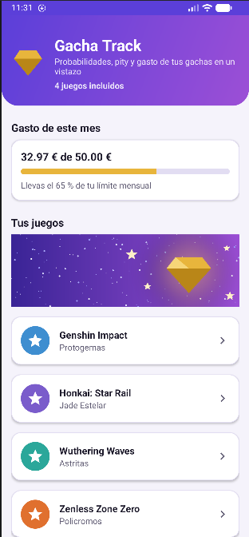
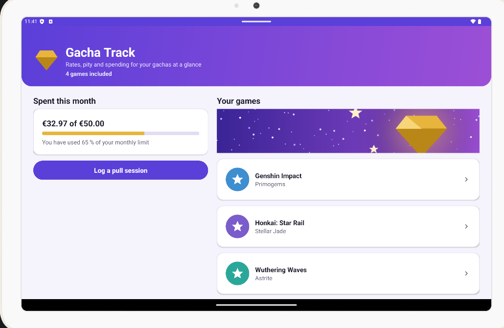
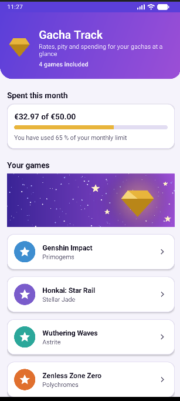
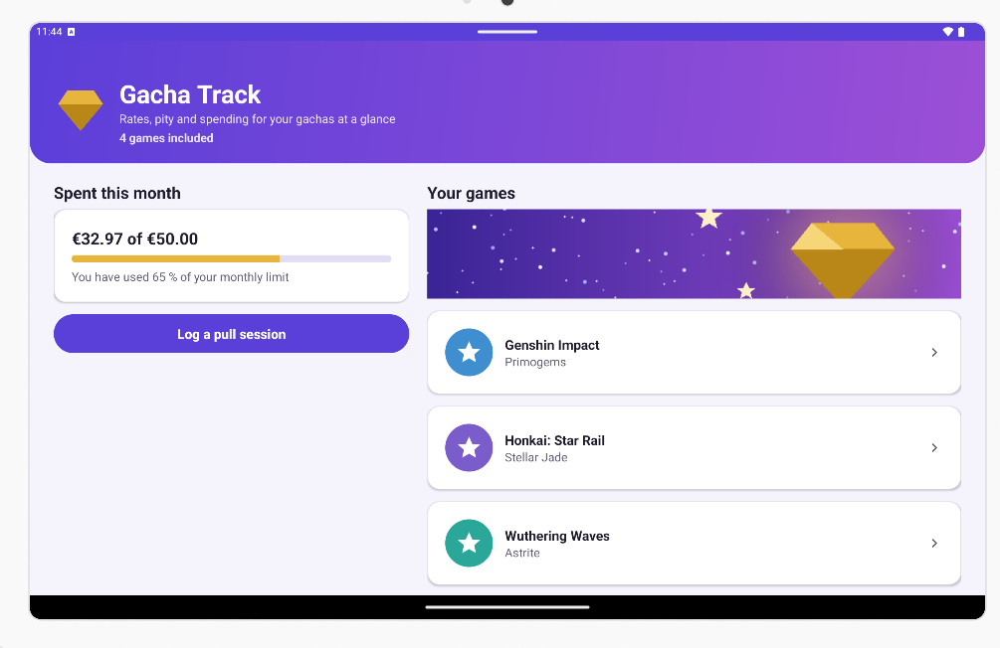
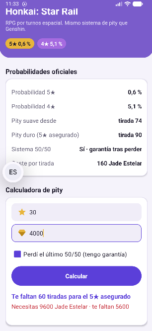
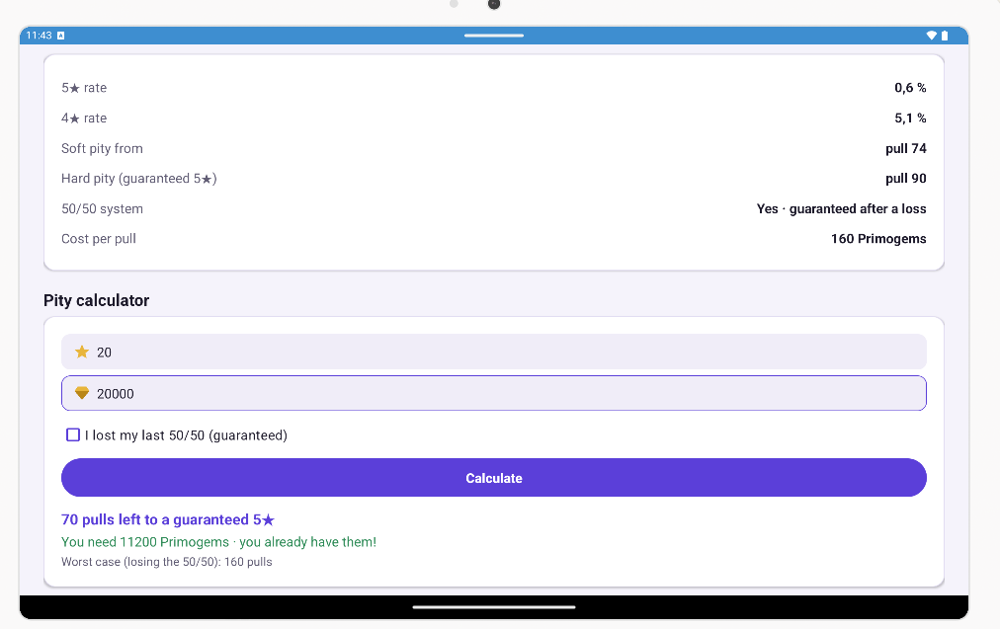

# Gacha Track

**PMDM · Práctica 1** — Jose Soto Mantegazza · CFGS DAM · MEDAC

Gacha Track es una app Android de información para jugadores de juegos gacha (Genshin Impact, Honkai: Star Rail, Wuthering Waves y Zenless Zone Zero). Reúne en una ficha por juego las probabilidades oficiales, el pity suave y duro y el sistema 50/50, e incluye una calculadora que dice cuántas tiradas y cuánta moneda del juego faltan para el 5★ asegurado. También muestra el gasto del mes frente a un límite, con un enfoque de consumo responsable.

## Capturas

| Pantalla | Móvil (Pixel 6) | Tablet (Pixel Tablet) |
| --- | --- | --- |
| Lista de juegos (ES) |  |  |
| Lista de juegos (EN) |  |  |
| Ficha + calculadora |  |  |

## Tecnologías

- Java + vistas XML (plantilla *Empty Views Activity*)
- minSdk 24 (Android 7.0) · targetSdk 34
- AndroidX AppCompat, Material Components

## Recursos destacados

- `values/strings.xml`, `plurals.xml` y `arrays.xml`, con traducción en `values-en/`
- `values/colors.xml` (paleta propia) y `values-night/colors.xml` (tema oscuro)
- `values/dimens.xml` y `values-sw600dp/dimens.xml` (tamaños para tablet)
- `values/styles.xml` y `themes.xml` (`Theme.GachaTrack`)
- `drawable/`: vectores (`ic_star`, `ic_gem`…), formas y selectores, y un PNG (`img_banner_wish.png`)
- Icono adaptativo en `mipmap-anydpi-v26/` + PNG en `mipmap-mdpi` … `mipmap-xxxhdpi`
- Layouts alternativos: `layout-sw600dp/` (tablet) y `layout-land/` (horizontal)

## Cómo ejecutarla

1. Clona el repositorio: `git clone https://github.com/pekejose39-collab/Mi-primera-app-Android.git`
2. Ábrelo en Android Studio (*File → Open*) y espera a que termine la sincronización de Gradle.
3. Crea o elige un AVD con API 24 o superior en *Device Manager*.
4. Pulsa **Run ▶**.

Repositorio: https://github.com/pekejose39-collab/Mi-primera-app-Android

La memoria completa está en [`docs/memoria.pdf`](docs/memoria.pdf).
